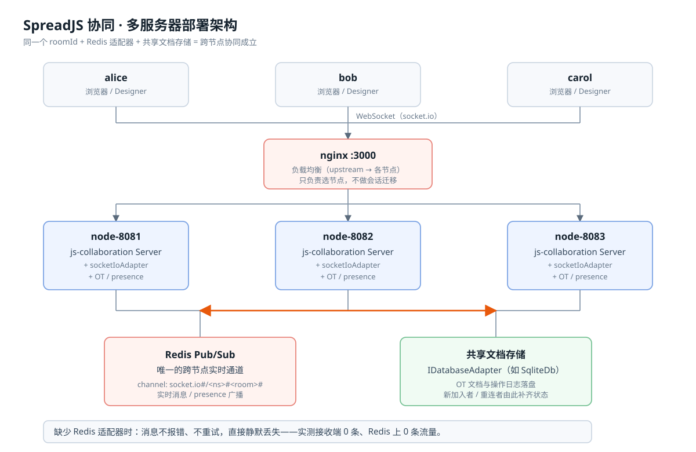
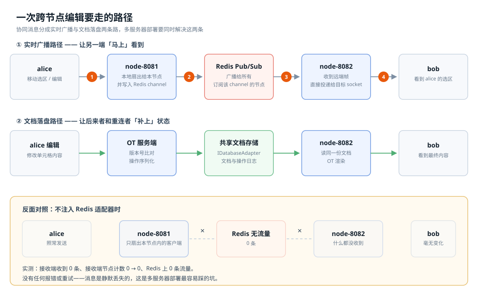

# 三种模式：用户和文档怎么分到节点上

先记住一件事：增加服务器进程以后，要同时考虑“谁服务这份文档”和“修改怎么送给其他人”。

## 先认识几个词

| 名称 | 含义 |
|---|---|
| 房间（room） | 一组共同编辑同一文档的用户，用 `roomId` 区分 |
| 节点（node） | 一个协同服务进程，占用一个端口 |
| 负载均衡（LB） | 接收连接，再选择一个节点处理 |
| 房间亲和 | 同一房间的连接固定交给同一节点 |
| Redis 适配器（adapter） | 让一个节点上的消息转发到其他节点 |
| 文档库（store） | 保存文档数据，供加入或重连时读取 |
| 实现（impl） | `mirror` 是本工程的简化演示；`real` 接入官方服务 |

默认的“多节点”都可以在一台电脑上运行。多台电脑的操作见 [多机手册](09-multi-machine.md)。

## single：所有人连一个节点

```text
所有房间的用户 → 一个节点
```

同一份文档的编辑都在这个节点里处理，消息直接转发给房间内其他用户。不需要 Redis，也不需要负载均衡。

适合首次体验、功能调试，以及单进程可以承载的场景。节点停止时，全部用户的协同都会中断。

```sh
npm run up -- --mode=single
npm run check
npm run down
```

## sharded：按房间分组

```text
                    ┌→ 节点 1：文档 A 的所有用户
用户 → 按房间路由 ──┼→ 节点 2：文档 B 的所有用户
                    └→ 节点 3：文档 C 的所有用户
```

同一份文档始终由同一个节点服务；不同文档可以分散到不同节点。节点间不转发消息，文档数据也各自保存。默认 mirror 的本地文档保存在内存中，重启会丢失。

这种方式适合很多相对独立的文档。增加节点可以分担不同房间的负载，但一个大房间仍由单节点承担。

入口必须按房间分配连接。如果把同房间的用户随机分给不同节点，他们会各自编辑自己的文档副本，互相收不到修改。节点故障或调整路由时，还需要考虑该房间的数据恢复；重新连到另一节点不代表旧数据会自动迁过去。

```sh
npm run up -- --mode=sharded
npm run check
npm run down
```

检查结果中，“跨节点同步”显示不适用是正常的：本模式要求同房间用户在同一个节点上完成同步。

## shared：同一房间可以跨节点



```text
                   ┌→ 节点 1 ─┐
用户 → 负载均衡 ───┼→ 节点 2 ─┼─ Redis：转发实时修改
                   └→ 节点 3 ─┘
                      └──────── 共享文档库：读取和保存文档
```

同一份文档的用户可以连接不同节点。某个节点收到编辑后，通过 Redis 适配器把消息发到其他节点；新加入的人则从共享文档库读取已有数据。

它适合验证同文档跨节点协作，但需要同时准备消息转发和共享存储。加节点能分摊连接和发送工作，无法消除“一次编辑需要通知所有协作者”的总成本，也不保证数据库写入能力随节点数增长。

```sh
npm run up -- --mode=shared
npm run check
npm run down
```

本工程共享的是同一台机器上的 SQLite 文件。它适合本机实验，不能直接扩展为跨主机共享数据库。工程尚未接入 PostgreSQL，跨真实主机的 shared agent 会被拒绝。



## 三种故意配错的例子

这些变体用来观察故障。正常模式里出现的失败需要排查；故意配错的项则会显示 `EXPECTED-FAIL`，报告结论通常是 `expected-broken`。

| 变体 | 故意改错什么 | 你会看到什么 | 需要 Redis |
|---|---|---|---|
| `broken-sharded` | 按房间分组，却用轮询分配连接 | 同房间用户分散到不同节点，互相收不到修改 | 否 |
| `broken-adapter-only` | 打开 Redis 转发，但每节点各存文档 | 实时修改能送到，换节点加入却可能读不到文档 | 是 |
| `broken-no-adapter` | 共享文档库，却关闭 Redis 转发 | 实时收不到修改，重新加入却可能看到正确数据 | 否 |

每次运行一个变体，结束后停止：

```sh
npm run up -- --variant=broken-sharded
npm run check
npm run down
```

要比较所有模式，可以运行 `npm run compare`；加 `-- --variants` 会包含错误配置。这条命令会依次启停部署，运行前先停止自己的演示。

## 怎么选下一步

只想理解三种模式，运行一次检查就够了。要决定自己的项目用哪种方式，继续看 [选型指南](03-decision-guide.md)。模式的默认配置与检查预期定义在 [src/lab/modes.mjs](../src/lab/modes.mjs)。
