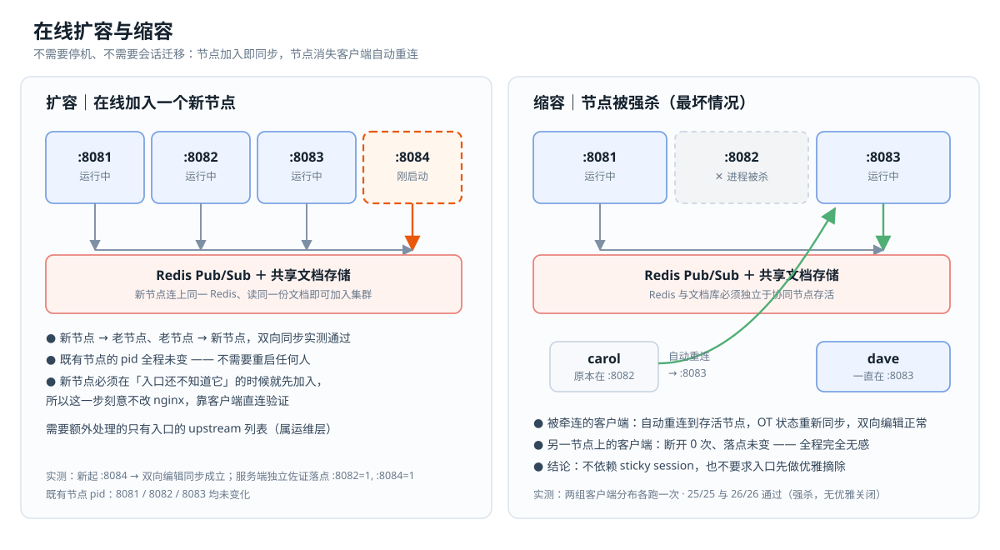

# 从实验走向生产前，需要补什么

这个工程用于学习和验证部署行为，尚未完成生产部署验证。复制配置之前，先明确自己的数据恢复、权限和可用性要求。

## 按模式检查

| 模式 | 必须考虑 |
|---|---|
| single | 单节点容量、数据持久化、重启后的恢复 |
| sharded | 同房间固定路由、节点本地数据的持久化与迁移、路由变化后的恢复 |
| shared | 所有节点使用同一套消息转发和共享存储；Redis 与数据库的可用性 |

Redis 适配器和共享文档库是 shared 的条件。sharded 通过固定房间路由工作，不要求节点间共享文档；不能笼统地说“多节点都必须用 Redis”。

## 入口与连接

生产入口通常由 nginx、HAProxy 或云负载均衡承担。确认支持 WebSocket upgrade，并根据心跳和空闲策略设置超时。

- sharded 要按 roomId 保持房间路由；仅按用户或连接粘住，不足以保证同文档用户聚在一起。
- shared 的房间不要求固定节点。本工程客户端只用 WebSocket；若改成 Socket.IO HTTP polling，还需按传输会话配置粘性。
- 部署到 HTTPS 页面时使用匹配的 HTTPS / WSS 入口，转发原始 Host 与协议信息。
- Socket.IO 的 `path` 作为选项传入，例如 `io(url, { path: '/collaboration/' })`；拼进 URL 可能被解释成 namespace。

[nginx.reference.conf](../config/nginx.reference.conf) 供参考，实验室自身运行的是 Node 负载均衡器。参考配置不包含你的证书、应用鉴权或完整健康策略，修改后需在目标环境验证。

## 文档存储

默认 mirror 的 `store=local` 使用进程内存，进程退出后数据丢失。`store=shared` 使用本机 SQLite 文件，可用于同机实验。

跨主机共享房间需要接入可并发访问的服务型数据库，例如 PostgreSQL，并实现对应存储逻辑。本工程**没有 PostgreSQL 接口或一键切换参数**。仅修改连接地址不能让当前 SQLite 实现跨主机工作。

数据库初始化应幂等。历史工程遇到过并发建表冲突和 SQLite 锁冲突，这些经验可以帮助设计重试，但重试必须有上限，并监控失败原因。发生未捕获异常时，应由进程管理器按策略重启并恢复，不能用“记录异常后继续运行”代替一致性保障。

## 管理接口与权限

控制台能启停进程、发起负载，节点也有状态和停止接口。目前这些服务面向受控实验环境，没有完整的用户鉴权与权限隔离。

- 默认保持本机监听；如需跨机实验，仅向受信网络开放必要端口。
- 控制台与 `/state`、`/shutdown` 等诊断接口不应作为业务接口暴露。
- agent 和负载均衡的动态节点管理接口使用 token，但这不覆盖整个管理面。
- `.lab/state.json` 保存启停所需凭据；授权文件保存在 `config/license.json` 或指定路径。不要将这些文件、日志和未经检查的报告公开。
- 使用有密码的 Redis 时，连接 URL 也属于凭据。当前部分日志和报告会包含 Redis URL，需要先脱敏。

本轮修复了控制台响应和 CLI JSON 中的管理 token 返回问题；这不等于完成了管理面的认证设计。

## 故障恢复与扩缩容

验证客户端能重连只是第一步。还需要测试：

1. 编辑发出但尚未收到确认时断线，是否丢失或重复应用。
2. 节点、Redis、数据库分别故障后，文档能否恢复。
3. sharded 增减节点、房间路由变化时，旧连接和新连接是否分裂到不同节点。
4. 灰度发布期间不同版本是否能共同工作。

需要不中断已有房间时，设计排空旧节点和迁移流程。共享存储与重连机制有助于恢复，但不是“任意强杀都安全”的保证。

## 观测与容量

至少记录每节点连接数、每房间人数、编辑速率、ACK 和广播延迟、失败率、断连重连次数，以及 CPU / 内存 / 网络。数据库锁等待、Redis 延迟也要纳入观察。

连接数是会话数量，不一定等于去重用户数；同一用户可以打开多个窗口。presence 用于展示光标等在线状态，不能直接当成精确在线人数或审计依据。

容量应使用你实际的 SDK 版本、工作簿、操作分布和网络测量。历史每秒广播量或预测核数只能作为起点，见 [性能与容量](05-performance.md)。

## 当前验证范围

本工程的自动测试覆盖本机进程、Socket.IO 转发、SQLite 共享和本机 agent 模拟。TLS、真实跨主机、Redis 高可用、数据库故障切换、复杂工作簿负载与完整权限体系仍需专项验证。官方实现另需 [商业授权](07-license.md)。
